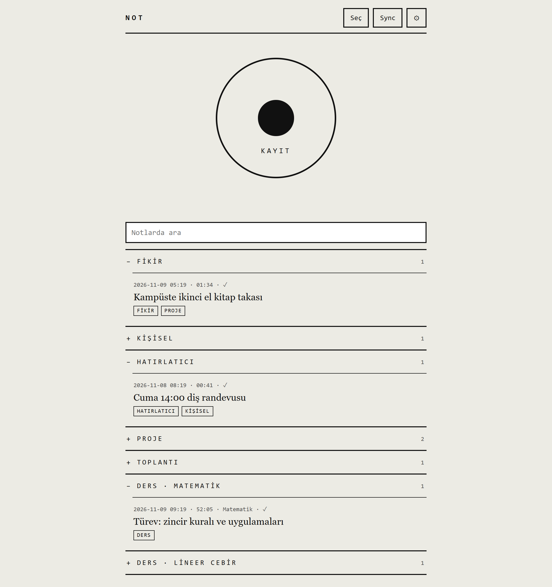
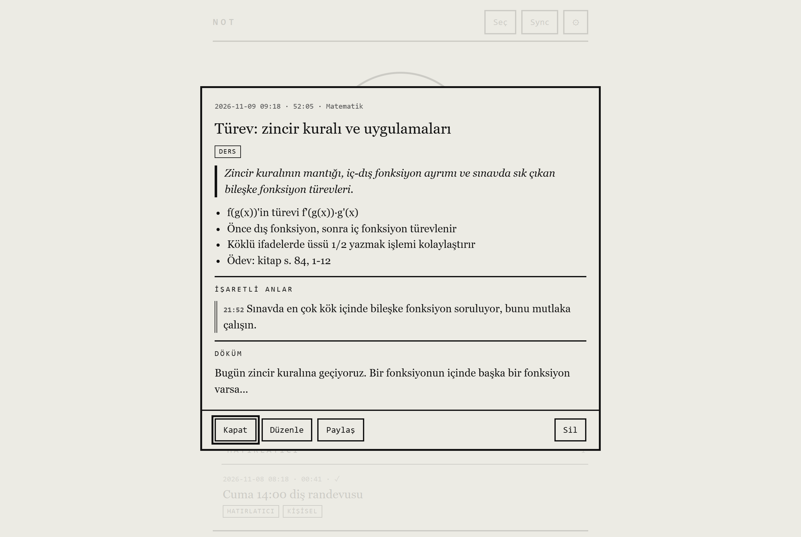
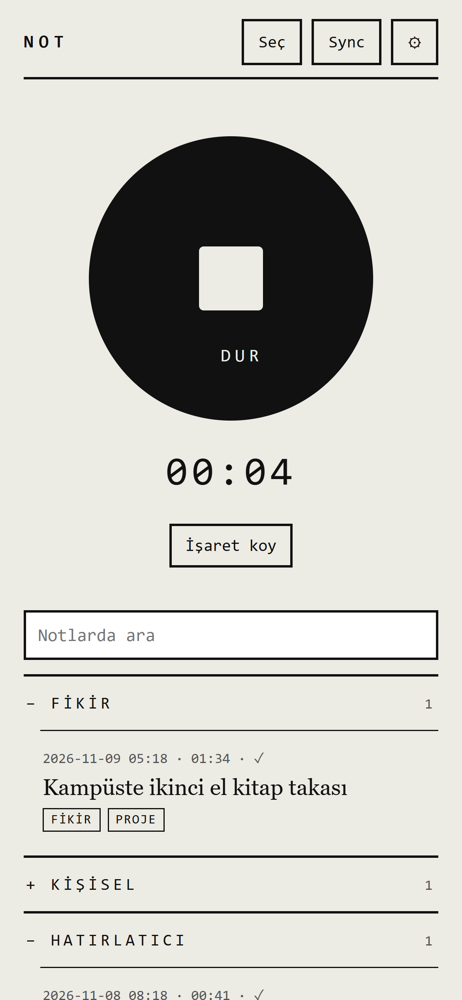
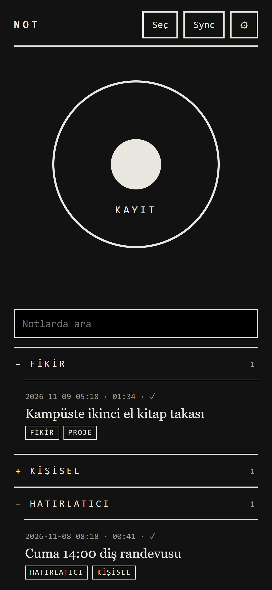

# Voice Note — tek düğmeli sesli not

Dokun, konuş, bırak. Uygulama konuşmanı yazıya döker, başlık koyar, etiketler, özetler ve notu Obsidian kasana `.md` dosyası olarak gönderir. Anlık fikirler için de, 1-2 saatlik ders kayıtları için de yazdım; kendi telefonumda ana ekrandan açılan bir uygulama olarak kullanıyorum.

**Canlı:** [mertbrks.github.io/voice-note](https://mertbrks.github.io/voice-note/) (kendi Groq anahtarınla çalışır, anahtar yalnızca senin cihazında kalır)

*A one-button, E-Ink styled voice note PWA: tap to record, Whisper transcribes, an LLM writes the title, tags, summary and key points, and the note is synced to an Obsidian vault through a private GitHub repo. No backend, free APIs only.*

## Ekran görüntüleri

*Görüntüler sahte demo notlarla alındı.*

**Ana ekran:** kayıt düğmesi, arama ve kategorilere ayrılmış notlar (dersler ders adına göre ayrı başlıkta)


**Not ayrıntısı:** yapay zekanın çıkardığı özet ve maddeler, kayıtta işaretlenen anlar, tam döküm


<p>
  
  &nbsp;
  
</p>

*Kayıt sırasında süre ve "İşaret koy" düğmesi · Karanlık mod (telefonun temasına göre kendiliğinden)*

## Ne yapıyor

- **Tek düğme:** dokun başlasın, dokun bitsin. Ekran kayıt boyunca açık kalır (Wake Lock).
- **Uzun kayıt:** ses 5 dakikalık parçalara bölünür ve 5 saniyede bir cihaza (IndexedDB) yazılır. Sayfa kapansa ya da internet gitse de kayıt kaybolmaz; çevrilemeyen parça sonra yeniden denenir.
- **Yazıya döküm:** Whisper (`whisper-large-v3-turbo`). Türkçe ve İngilizce kendiliğinden algılanır; Whisper başka bir dil sanırsa o parça Türkçe olarak yeniden çevrilir.
- **Düzenleme:** dil modeli (`gpt-oss-20b`) dökümden başlık, 1-3 etiket, kısa özet ve önemli maddeleri çıkarır. Uzun derslerde önce her parça özetlenir, sonra özetlerin özeti alınır.
- **İşaret koy:** kayıt sırasında önemli bir anda düğmeye basarsın; notta "İşaretli anlar" bölümünde o anın 20 saniye öncesi ve 5 saniye sonrası metin olarak durur.
- **Kategoriler:** Ders, Fikir, Kişisel, Hatırlatıcı, Proje, Toplantı. Ders notları ders adına göre ayrı başlıkta toplanır (örn. "Ders · Matematik"). Birden çok etiketli not her kategorisinde görünür.
- **Hatırlatıcı:** "Cuma saat ikide dişçi randevum var" dersen tarih ve saat çıkarılır; notta Apple Takvim ve Google Takvim'e ekleme bağlantısı çıkar.
- **Obsidian'a gönderme:** notlar özel bir GitHub deposuna Markdown (başlık, etiketler, tarih ön bilgisiyle) olarak yazılır. Bilgisayarda bu depo Obsidian kasası olarak açılır ve tek tıkla çekilir. Notu düzenlersen aynı dosyanın üstüne yazılır.
- **Notion (isteğe bağlı):** küçük bir Cloudflare Worker (`notion-worker.js`) üzerinden Notion veritabanına da sayfa açar.
- **Diğer:** arama, notu elle düzenleme, toplu seçip silme, sesleri de içeren yedek indirme / geri yükleme, karanlık mod, çevrimdışı açılma.

## Teknik

- **Sunucu yok:** sade HTML, CSS ve JavaScript (framework yok). Tarayıcı doğrudan Groq ve GitHub API'sine gider.
- **Yapay zeka:** [Groq](https://groq.com) ücretsiz katmanı, tek anahtar. Ses: `whisper-large-v3-turbo`. Metin: `openai/gpt-oss-20b`, JSON çıktı.
- **Kayıt:** MediaRecorder, IndexedDB (notlar ve ses parçaları ayrı depolarda).
- **PWA:** manifest + service worker; iPhone ve Android'de ana ekrana eklenir.
- **Gizlilik:** API anahtarları yalnızca cihazdaki `localStorage`'da. Notlar senin özel deponda.

```
index.html          arayüz ve stiller (E-Ink görünümü, açık/koyu tema)
app.js              kayıt, IndexedDB, Groq çağrıları, GitHub / Notion senkronu, arayüz
lib.js              saf yardımcılar: Markdown üretimi, metin bölme, işaretli anlar, takvim bağlantısı
sw.js               çevrimdışı önbellek
notion-worker.js    Notion için Cloudflare Worker aracı (isteğe bağlı)
test.mjs            lib.js öz-testleri
```

## Kurulum

1. [console.groq.com](https://console.groq.com) adresinden ücretsiz bir API anahtarı al.
2. Notlar için GitHub'da **özel** bir depo aç (örn. `voice-notes`) ve yalnızca o depoya *Contents: Read and write* izni olan bir fine-grained token oluştur.
3. Uygulamayı aç, ⚙ ayarlara anahtarı, token'ı ve `kullanıcı/depo` adını yaz.
4. Telefonda Paylaş → **Ana Ekrana Ekle**.
5. Bilgisayarda notlar deposunu klonla ve klasörü Obsidian'da *Open folder as vault* ile aç. Yeni notlar için `git pull` yeterli.

Yerelde çalıştırmak için herhangi bir statik sunucu yeterli:

```bash
python -m http.server 8000      # http://localhost:8000
node test.mjs                   # öz-testler
```

## Sınırlar

- Groq ücretsiz katmanı: saatte yaklaşık 2 saatlik ses, dakikada 8 bin token metin. Arka arkaya birkaç uzun ders yüklenirse işlem sıraya girer.
- iPhone'da ekran kilitlenince ya da uygulamadan çıkınca tarayıcı kaydı durdurur.
- Hatırlatıcılar bildirim göndermez, takvime eklenmesi gerekir.
